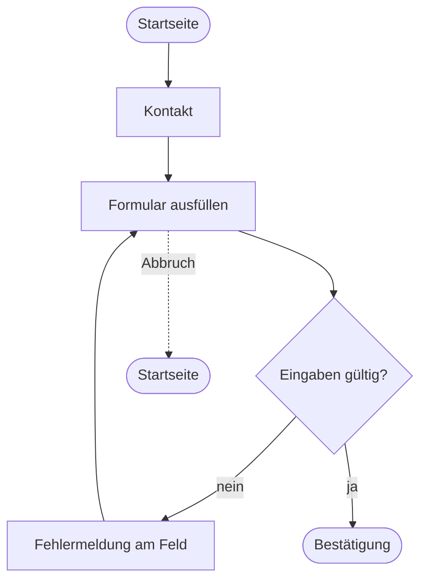

# 08.2 User Flows

> Modul 08 · Lehrplan 8.3 · Geschätzter Zeitaufwand: 45 Minuten

## Lernziele

- Du zeichnest einen User Flow mit Schritten, Entscheidungen und Fehlerfällen.
- Du erkennst Sackgassen und vermeidest sie.
- Du nutzt Mermaid, um Flows als Text zu versionieren.

## Voraussetzungen

08.1

## Ausgangslage

Du hast User Stories. Jetzt zeigst du den Weg zum Ziel.

## Aufgabe

1. Notation: Was bedeuten Rechteck, Raute und Pfeil im Flowchart?
2. Zeichne den Flow „Termin buchen“ aus dem Lehrplan als Text oder Skizze: Startseite → Leistung wählen → Termin wählen → [Angemeldet?] → … Nenne mindestens drei Fehlerfälle.
3. Zeichne den Flow „Kontakt aufnehmen“ für dein Portfolio, inklusive Fehlerfall und Abbruch. Nutze Mermaid ([`../portfolio/modul-08/docs/user-flows.md`](../portfolio/modul-08/docs/user-flows.md) als Vorlage).
4. Zeichne den Flow „Blogbeitrag lesen“. Wo droht eine Sackgasse?
5. Prüfe dein Diagramm: Hat jeder Pfad ein Ziel oder einen Rückweg?

## Hinweise

- Ein User Flow zeigt den Weg, kein Layout. Er enthält keine Farben und keine Positionen.
- Fehlerfälle gehören hinein, sonst zeichnest du nur den Idealweg.
- Mermaid-Code kannst du direkt in einer `.md`-Datei auf GitHub schreiben, er wird dort gezeichnet. Der Vorteil: Änderungen sind in Git sichtbar.

---

## Lösung

1. Rechtecke sind Schritte oder Seiten, Rauten sind Entscheidungen, Pfeile sind Wege.
2. Startseite → Leistung wählen → Termin wählen → [Angemeldet?] ja: Daten bestätigen, nein: Gastdaten eingeben → Bestätigung → E-Mail mit Termin. Fehlerfälle: Termin nicht mehr frei, ungültige E-Mail, Abbruch (Daten bleiben erhalten).
3. Mermaid:

4. Eine Sackgasse entsteht, wenn der Beitrag keinen Link zurück zur Übersicht oder zu weiteren Beiträgen hat. Siehe Flow 3 im fertigen Dokument.
5. Alle drei Flows in [`../portfolio/modul-08/docs/user-flows.md`](../portfolio/modul-08/docs/user-flows.md). Die Mermaid-Syntax wurde mit dem Mermaid-CLI gerendert, alle drei Diagramme sind gültig.

## Erweiterungen

- Ergänze im Kontakt-Flow den Fall „JavaScript ist aus“ (Modul 12).
