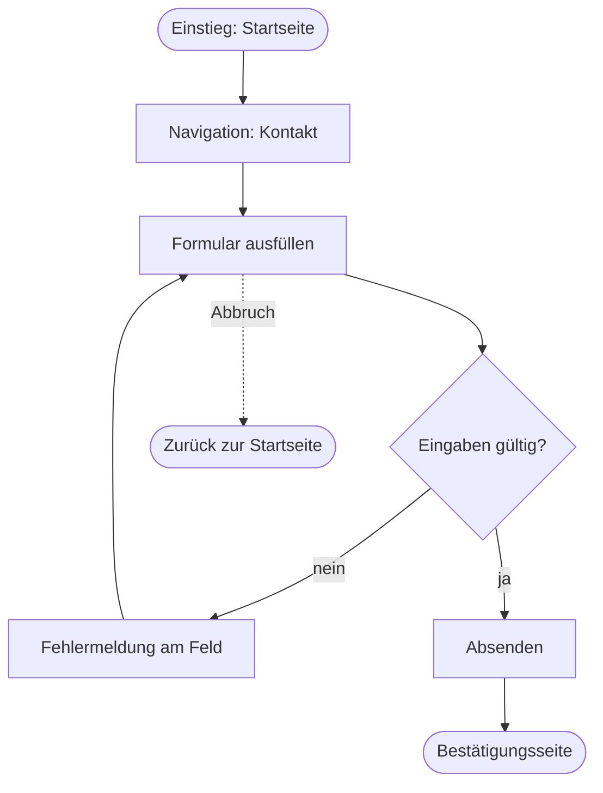
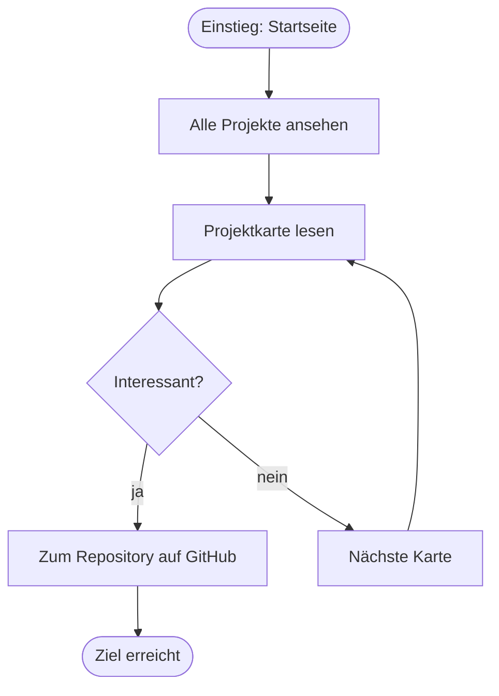
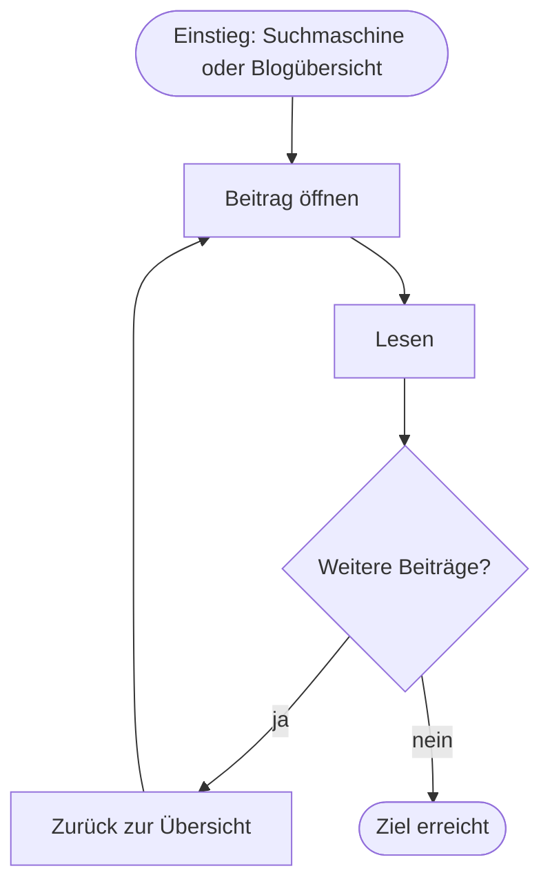

# User Flows

Mermaid-Diagramme werden von GitHub direkt gerendert. Im Editor siehst du sie je nach Vorschau nur als Text.

## Flow 1: Kontakt aufnehmen

Fehlerfälle: ungültige E-Mail, leere Pflichtfelder, Abbruch. Die Eingaben bleiben beim Fehler erhalten.

## Flow 2: Projekt ansehen

## Flow 3: Blogbeitrag lesen

Sackgassen gibt es nur dann nicht, wenn jeder Beitrag einen Link zurück zur Übersicht hat.
